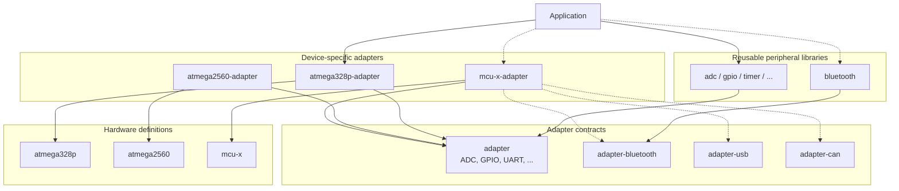

# Architecture

MCU Definitions is a modular C++ ecosystem for hardware definitions, peripheral interfaces, device-specific implementations, and reusable libraries. Each component can be maintained and versioned independently.

The architecture does **not** require a single, mandatory hardware core. Projects include only the components they need.

## Components

| Component | Responsibility | Examples |
| --- | --- | --- |
| **Hardware definitions** | Describe a device's registers, bit fields, peripherals, and hardware constants. No operational driver logic. | `atmega328p`, `atmega2560` |
| **Core adapter contracts** | Define reusable peripheral interfaces with abstract classes. | `adapter` (`adc`, `gpio`, `timer`, `spi`, etc.) |
| **Optional adapter contracts** | Define specialized interfaces separately when reuse justifies a shared contract. | `adapter-bluetooth`, `adapter-usb`, `adapter-can` |
| **Device adapters** | Implement applicable contracts using the definitions of a specific MCU. May also expose device-only features. | `atmega328p-adapter`, `atmega2560-adapter` |
| **Peripheral libraries** | Provide reusable, higher-level operations against contracts rather than a particular MCU implementation. | `adc`, `gpio`, `bluetooth` |
| **Application** | Select a device adapter and combine it with the libraries it needs. | An embedded C++ project |

The names of optional contract and peripheral-library repositories above are **examples of possible future repositories**, not a required repository list.

## Dependency architecture

Arrows point **from the component that depends on something to the component it uses**. Dashed arrows represent optional dependencies.



The application links the **concrete device adapter** to libraries built against the relevant **interfaces**. A reusable library does not need to depend on `atmega328p-adapter` or any other specific device adapter.

## Implementing an MCU adapter

1. Depend on the MCU's hardware definitions and the applicable contract repositories.
2. Implement each supported peripheral interface using inheritance and `override`.
3. Add device-specific functionality directly to that MCU adapter when no reusable contract is needed.
4. Expose the available peripherals through an `MCU` class.
5. Instantiate the MCU directly using its constructor.

For example, after an MCU adapter has implemented its ADC:

```cpp
MCU mcu;

auto& adc = mcu.adc();

adc.start_conversion();
```

This is a simplified usage example; concrete includes and type names depend on the selected device adapter. The peripheral implementation must satisfy the applicable abstract interface before it can be instantiated.

## Optional and device-specific features

**Not every MCU must implement every contract.** An MCU without Bluetooth, for instance, has no Bluetooth implementation or placeholder methods.

- **Shared capability:** If multiple devices expose a sufficiently consistent Bluetooth interface, define its contract in `adapter-bluetooth`. Each supporting MCU adapter implements that contract. A reusable Bluetooth library can depend on it.
- **Device-only capability:** The ATmega2560's external memory interface (XMEM) can initially live only in `atmega2560-adapter`, using `atmega2560` hardware definitions. It does not need to be added to the core `adapter` repository.
- **External hardware module:** A separate Bluetooth module connected over UART or SPI is normally handled by a module driver/library that uses the MCU's UART or SPI interface, rather than pretending Bluetooth is built into the MCU.

A specialized contract becomes worthwhile when it provides a meaningful, reusable interface. It is **not** necessary to create a repository for every uncommon peripheral.

## Design principles

- Keep hardware definitions independent of adapters and higher-level libraries.
- Keep contracts hardware-agnostic, focused, and independently reusable.
- Implement only capabilities actually supported by each device.
- Separate hardware access in device adapters from convenience APIs in peripheral libraries.
- Keep contracts and examples compatible with C++11.
- Use optional interfaces and dependencies instead of forcing unsupported functionality into every MCU.
